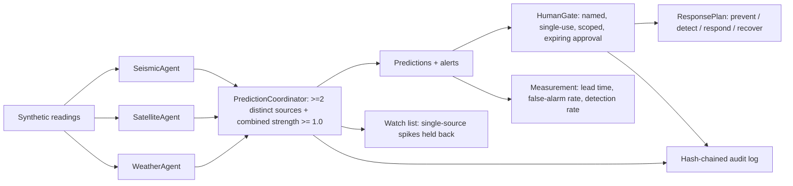

# Jagadish-environmental-monitoring-agents

## Recruiter summary

Environmental monitoring as a multi-agent system for a fictional
operator, Sorrelmere Environmental: SeismicAgent, SatelliteAgent, and
WeatherAgent produce correlation signals that feed a
PredictionCoordinator, which issues predictions and alerts only when
distinct sources corroborate each other. Alert triage sits behind a
human gate — alerts are never auto-escalated to external action.
Proof, from a real local run: **62 tests green**; demo stream of
5 synthetic events produced 6 predictions (5 matched, 1 false alarm),
a false-alarm rate of 0.1667, mean prediction lead time of 90.0
minutes, detection rate 1.0, 2 lone spikes held back, 1 of 6 alerts
escalated through a named approval, and 26 audit entries verified.
All data is synthetic and fictional; nothing here touches real
sensors, real events, or real response operations.

## Purpose and who it is for

For environmental-monitoring, risk, and operations teams that need to
answer a practical question: when do several weak signals, taken
together, justify acting — and when is a single loud sensor just
noise? It demonstrates the agentic pattern — prevent, detect,
respond, recover, govern, measure — applied to environmental
signals, with human gates at every consequential step.

This project is an independent portfolio demonstration. It is not
affiliated with, endorsed by, or connected to any real monitoring
agency, satellite operator, or environmental company, and it is not
a system for real hazard warning or emergency response.

## Architecture



See also [docs/architecture.md](docs/architecture.md) and
[knowledge/architecture-diagram.md](knowledge/architecture-diagram.md).

## How it works, step by step

1. Each agent turns a synthetic reading into a signal, or nothing
   when the reading is below its detection floor (seismic magnitude
   < 3.0, satellite anomaly < 0.40, pressure drop < 8 hPa).
2. The PredictionCoordinator groups signals by region inside a
   180-minute window. A prediction issues only when at least two
   distinct sources signalled and their combined strength reaches
   1.0. A single signal can never reach 1.0 alone (strengths cap
   at 0.95), so lone spikes stay on the watch list.
3. Predictions become alerts. Triage sits behind the HumanGate:
   approval needs a named person, an unambiguous "yes" (a
   self-contradicting "yes, wait, no" is rejected), confidence at
   or above 0.65, a matching scope, and an unexpired, unused
   approval. Alerts are never auto-escalated.
4. An approved escalation unlocks a ResponsePlan covering prevent,
   detect, respond, and recover actions; the recover phase stands
   monitoring down and files the outcome.
5. Every signal, prediction, and escalation is appended to a
   hash-chained audit log, and Measurement scores the stream:
   lead time, false-alarm rate, and detection rate.

## Real code excerpts and their real output

```python
coordinator = PredictionCoordinator()
coordinator.ingest(SeismicAgent().observe("Sorrelmere North Basin", 480, 4.0))
prediction = coordinator.ingest(SatelliteAgent().observe("Sorrelmere North Basin", 510, 0.55))
prediction.lead_minutes(600)  # 90
```

```
$ PYTHONPATH=src python3 run_demo.py
events=5
predictions=6
matched=5
false_alarms=1
false_alarm_rate=0.1667
mean_lead_minutes=90.0
detection_rate=1.0
held_back=2
alerts=6
escalated=1
plans_executed=1
audit_entries=26
audit_verified=True
budget_demo=1500.0
```

## How to run

```bash
PYTHONPATH=src python3 -m pytest tests/
PYTHONPATH=src python3 run_demo.py
python3 scripts/count_tests.py
```

Standard library only; no network calls, no real sensor feeds,
no deployment. Requires Python 3.10+ and pytest.

## Guardrails and security controls

- Human gate: named-person, single-use, scoped, expiring approvals;
  bypass, reject, and absent-path tests, plus low-confidence and
  self-contradicting-consent tests.
- PII redaction checklist covers phone numbers, SSNs, card numbers,
  and email addresses in log and alert text.
- Hash-chained audit log; tampering breaks verification (tested).
- Cost/budget inputs reject negatives instead of clamping silently.
- Brand/name check with a blocklist stored as hashes, asserted
  non-empty in a test; the fictional operator name is not blocked.
- Synthetic/fictional data only; no real events, places, or people.

## Limitations and known failures

- All signals, events, and outcomes are synthetic: lead time and
  false-alarm rate describe this demo stream, not real-world skill.
- The coordinator correlates by region and time window only; it
  does not model sensor failure, location error, or event magnitude.
- The false alarm in the demo (1 of 6 predictions) is intentional:
  correlated signals with no following event still predict. Tuning
  the combined threshold trades false alarms against missed events
  and is not tuned here.
- CI workflow is included in the scaffold but has not been run;
  CI status is NOT verified (see table below).

## Built / Written-not-run / Planned

| Item | Status |
| --- | --- |
| Seismic, satellite, weather agents | Built, tested |
| PredictionCoordinator correlation rule | Built, tested |
| Human gate for alert triage | Built, tested |
| Response plans (prevent/detect/respond/recover) | Built, tested |
| Hash-chained audit, PII redaction, brand check, budget guards | Built, tested |
| Measurement (lead time, false-alarm rate, detection rate) | Built, tested |
| CI workflow (`.github/workflows/ci.yml`) | Written, NOT run — CI NOT verified |
| Deployment, live sensor feeds, real alerting integrations | Planned only (not built) |

## Docs

- [docs/architecture.md](docs/architecture.md)
- [docs/implementation-guide.md](docs/implementation-guide.md)
- [docs/threat-model.md](docs/threat-model.md)
- [docs/adr/0001-correlation-as-confirmation.md](docs/adr/0001-correlation-as-confirmation.md)
- [knowledge/notes.md](knowledge/notes.md)
- [knowledge/architecture-diagram.md](knowledge/architecture-diagram.md)
