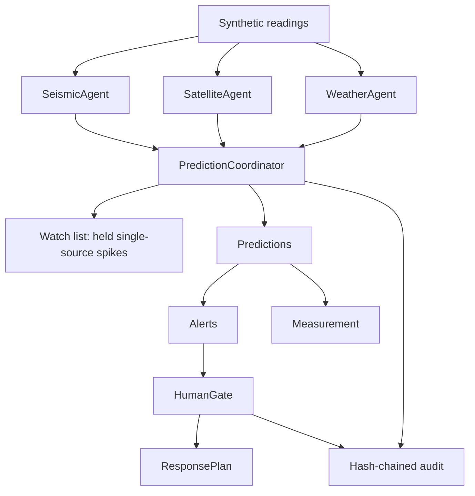

# Architecture

Agents observe; the coordinator confirms; the gate authorises;
the plan acts. No agent can escalate, and no prediction can reach
an external action without a named human approval.

Key decisions are recorded in
[adr/0001-correlation-as-confirmation.md](adr/0001-correlation-as-confirmation.md).
